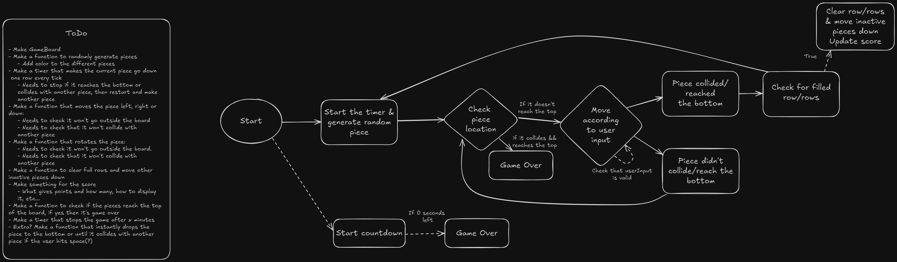

# TetrisClone
A TetrisClone I made for an assignment.

## The Plan

A sequence diagram I made for how I've planned that the program should work. It also contains a ToDo List of the functions I want/plan to implement.

## How to run the application
You can either clone the repository in Visual Studio and run it there, or download the application from Releases [here](https://github.com/Katelli/TetrisCloneAssignment/releases). For some reason it didn't recognize that I put myself as the author, so you'll probably get an alert about an "unknown publisher". This is my first try at making an installer for an application, so do let me know if I forgot anything or if you have any tips for beginners!
